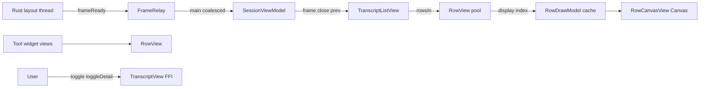

# Android native core transcript painter

## Goal

Replace the M1 Compose `Text` + `messageText` path with a native Android painter that consumes `LayoutFrame.display(index)` (`RowDisplay`, placements, styles) while preserving Rust layout geometry. Demo and live sessions keep M3b composer/send/auth; users can inspect rich markdown via demo workspace sessions and a dedicated transcript lab entry.

## Non-goals

- Third-party markdown parsers, WebView rendering, FFI/schema changes.
- Network image loading, live agent `Visual` sessions (placeholder + a11y only).
- CI Gradle builds on this VPS task (device visual validation pending).
- iOS, scripts, workflows, or generated binding edits (unless a follow-up explicitly approves them).

**Historical (pre–Markdown images phase):** early milestones treated `crates/**` as out of scope. **Current approved narrow Rust scope:** `crates/mobile/src/layout/markdown.rs` and layout regressions in `tests.rs` only — embeddable `` → `WidgetKind.Image`, `copy_text` preservation, streaming display mend contract. No `crates/markdown` parser changes.

## Status (2026-10-22)

Review blockers addressed in `apps/android/**`: Geist via `createFromAsset`, math via `Font.Builder` + `Canvas.drawGlyphs` (API 31+) with explicit `MATH_REFERENCE_SIZE` on the paint, logical-dp viewport + canvas density scale, scroller inner `FrameLayout`, frame lifecycle (revision idempotency closes duplicate wrappers; `renderEpoch` on theme/style), hydration on `frameReady` + app refresh tick, lab **Replay streaming** top-bar action (composer locked in lab), JVM unit tests wired via lazy `tasks.matching { assembleDebug }`.

**PR26 feedback (2026-10-22):** Compact transcript via `TranscriptViewportScale` (`0.88f × Configuration.fontScale` → `setViewport` only). Compose + native clipping (`clipToBounds`, `TranscriptListView.dispatchDraw` clip, `RowView.clipChildren`). Glass-inspired opaque composer (`GlassInspired.kt`). `WidgetKind.Image` loads through `CoreClient.readAttachment(hostDeviceId, reference)` with bounded decode + session LRU; lab uses `LAB_DEMO_IMAGE_REFERENCE` (in-memory gradient, no FFI) and a **Markdown** `` row with the same path. `zeron-preview://image?ref=` opens in-app preview. **Markdown image support boundary (mobile layout):** local absolute paths, Windows/UNC paths, and `pending://…` references become `WidgetKind.Image`; `https:`/`http:`, `file:`, `data:`, `javascript:`, relative paths, and overlong sources stay alt + link (no URL/file-type guessing). Ordinary `[label](path)` links are never promoted to image widgets. `readAttachment` is not chat-scoped — host path jail on the engine applies.

**Scroll-to-latest (2026-10-22, pending CI/device):** When the user reads history (`following = false`) and remaining scroll distance from the live bottom exceeds **240 dp** (px threshold computed once from view density), show a bottom-centered opaque “Latest” control (12 dp above the transcript box bottom; scaffold already clears the composer). Visibility is driven by `TranscriptAnchor.shouldShowScrollToLatest(scrollY, maxScroll, thresholdPx)` on real `NestedScrollView` offsets (not row estimates), gated until after the initial bottom scroll / layout pass. `TranscriptListView` posts visibility deltas to `SessionViewModel`; tap calls `jumpToLatest()` (instant scroll to current `maxScroll`, `following = true`, pending jumps cancelled on user scroll/unbind). Follow-tail semantics unchanged (70 dp resume threshold). Acceptance: manual checklist items below; JVM tests for the pure helper only.

**Rollback:** Revert the `feat/android-native-transcript` branch; no schema or Rust changes.

## Verified sources

| Area | Path |
|------|------|
| Display contract | `crates/mobile/src/layout/display.rs`, `mod.rs` (`display`, `rowsIn`, `placement`) |
| iOS reference | `apps/ios/Zeron/Transcript/*`, `Design/Palette.swift`, `Core/Fonts.swift` |
| Kotlin FFI (names/types) | `/root/.hermes/profiles/girlfriend/cache/scratch/kbind/uniffi/zeron_core/zeron_core.kt` |
| `closeView` patch | `scripts/android/patch-kotlin-bindings.py` (read-only) |
| Recon | `/root/.hermes/profiles/girlfriend/cache/scratch/native-painter-recon.json` |
| Chip fix baseline | `c51aa858` (`ComposerBar.kt` compact typing-only chips) |

## Decisions

1. **Hosting**: `TranscriptListView` (`NestedScrollView` + pooled `RowView`) inside Compose `AndroidView`; not a full `LazyColumn` of text.
2. **Coordinates**: Viewport width = measured content width in **logical dp** (container minus 16dp padding), `setViewport(widthDp, textScale)` with `textScale = TranscriptViewportScale.viewportTextScale(Configuration.fontScale)` (`0.88f` Android body dampening × accessibility scale, not clamped). Row views and widgets use px layout params = dp × density; `RowCanvasView` scales the canvas by density only (no second font scale on canvas).
3. **Fonts**: Shared `GeistTypefaces` from assets for `AndroidPlatformMeasurer` and `StyleFonts`; missing assets fail fast (no silent system fallback).
4. **Enumeration**: Virtualize with `frame.rowsIn(y0, y1)` + `placement`; cache `RowDrawModel` keyed by `(key, version, width)` (cap ~500), built synchronously on main (no background prefetch).
5. **Frames**: `FrameRelay` coalesces `frameReady`; capture scroll anchor before closing previous frame; compute empty/first-row before close; revision idempotency closes unused `frame()` wrappers (`current === frame` never holds); theme/style bumps `renderEpoch` and reconfigures visible rows; all FFI on main thread.
6. **Lab**: Demo session id `__zerona_transcript_lab__` uses `setDebugEntries` without `attach`. Static fixture markdown is laid out (widgets in fixture content only). **Replay streaming** (top bar) streams UTF-16-safe prefixes of lazy `layoutFixtureMarkdown()` into fixed id `a-stream`. Composer locked in lab; does not claim to test live host tool streams.
7. **Math**: `mathFontData` + `Font.Builder` / `Canvas.drawGlyphs` isolated in `MathGlyphsApi31` (`@RequiresApi(31)`); `RowDrawModel` / `MathFonts` facade use only `Canvas` + primitives so minSdk 26 never loads `android.graphics.fonts.Font`. API &lt; 31: labeled “Math” placeholder at glyph bounds (no silent empty square). Reference size 16 (matches iOS `Fonts.mathReferenceSize`; no separate FFI).
8. **Widgets**: Native controls for copy, disclosure, tool status/spinner/working (elapsed label ticks), toggles (`!open`), detail `AlertDialog` + copy, simplified tool rail/shimmer (animator tied to attach/detach). **Images**: `SessionImageLoader` + `TranscriptImageWidget` (`uniffi.zeron_core.maxAttachmentBytes()` cap, `readAttachment`, per-type MIME sniff, sampled decode ≤2048 px edge / ≤16 MiB ARGB per bitmap, session LRU ~16 MiB retained — live widgets may hold additional decoded bitmaps); preview via view `Context` → session-owned `ImagePreviewController` (single dialog, retry, ~70% window; no static dialog state). Lab-only absolute `LAB_DEMO_IMAGE_REFERENCE` (`/__zerona_android_lab__/fixture.png` in attachment trailer) → in-memory gradient; never FFI.
9. **Composer UI**: Full-width opaque backdrop + glass-inspired floating card (gradient sheen, hairline border, elevation); `OutlinedTextField` opaque containers all states; 14 sp body input. No `Modifier.blur` on composer (readability first).
10. **Clipping**: `AndroidView` + hosting `Box` use `clipToBounds`; `TranscriptListView` clips scroll viewport in `dispatchDraw` using `(scrollX, scrollY, scrollX+width, scrollY+height)`; `RowView.clipChildren = true` so transcript does not paint through composer region visually.

## Data flow

## Tests

| Layer | Status |
|-------|--------|
| JVM unit (**182** `@Test` method annotations in **23** test classes, static inventory — not executed native/device count, no JNA): UTF-16 slice/clamp/`isValidRange`/surrogate, per-scalar advance aggregation (`TextMeasureAdvances`), link hit-test (scroller viewport), anchor helpers (follow + scroll-to-latest threshold), cache key equality, streaming prefix targets, `TranscriptViewportScale`, `ImageAttachmentSupport` (MIME, sample plan, preview URL/query parsing, percent-decode, host cache key, stale guard, `ViewportClip` helper), `TranscriptMessageActionsSupport` (clipboard/selection UTF-16 caps, exact link token, dedupe), design tokens/contrast/composer presentation helpers, `ModelLabelPresentation` | Under `app/src/test`; `tasks.matching { assembleDebug }` depends on `testDebugUnitTest`; `apps/android/scripts/selfcheck-native-transcript.sh` for static callsite/import checks |
| Rust layout (`crates/mobile/src/layout/tests.rs`) | **15** Markdown image regressions (`embeddable_image_reference`, local/pending/mixed/streaming mend, narrow + same-line non-overlap ink rects, link/code fallbacks, cap 16); run via macOS `ios-core` / `cargo test -p zeron-mobile` when mobile layout changes — **pending CI log on parent push** |
| `assembleDebug` / on-device | **Pending** — not run on this VPS (no Android SDK compile here) |

### Manual acceptance (pending device)

- [ ] Font scale 0.85–1.3: layout reflow via `setViewport`; transcript not clipped incorrectly
- [ ] Composer/input/chips: no transcript bleed while scrolling or with IME (light/dark)
- [ ] Image widget: lab demo fixture; signed-in host attachment / generated image; offline/error/retry; scroll recycle; viewer open/close
- [ ] Large transcript scroll: no duplicate messages, tool-only rows visible, stable FPS
- [ ] Code block horizontal scroll + copy button
- [ ] Streaming tail veil on growing row
- [ ] Tool group disclosure, tool toggle detail, working/spinner chrome
- [ ] http/https links open externally; `zeron-preview` stays in-app; other schemes ignored
- [ ] Rotation / session switch / follow-tail vs anchor
- [ ] Demo lab + live session composer send regression
- [ ] Long-press copy uses row `copyText` / whole-message text where applicable
- [ ] Lab Markdown `` image row loads lab fixture; plain `[.png](…)` link offers Copy link only
- [ ] Lab replay streaming streams fixture markdown; live tool streams still session-only
- [ ] **Scroll-to-latest:** long session scrolled far up → “Latest” visible; tap jumps to bottom and hides; new messages while reading history stay anchored; after jump, streaming tail follows; keyboard open/close and rotation; short/empty transcript → control hidden

## Known limitations

- `reveal_ms` on `TextRun` not animated (same as iOS painter).
- Tool rail connector animation simplified vs iOS `ToolRailView`.
- Shimmer is a reduced gradient sweep.
- Markdown `` with `https:`/`http:`, `file:`, relatives, or jail-breaking paths stay links/alt text (no widget). Streaming incomplete destinations use mend `zeron:pending-link` in the display AST until the source completes — not emitted as host image widgets.
- Long-press **View source** compares whole-message text (`LayoutFrame.messageText`) to the visible block; per-row `copy_text` is the trimmed markdown slice for that layout block (joined blocks may normalize spacing) — not a guaranteed byte-identical full message source.
- **Select text** opens an Activity-scoped selectable `TextView` panel (handles), not in-place cross-row Canvas selection.
- `Visual` widgets: placeholder + `setVisualSource` wired for future scripts; no live visual player in this milestone.
- `readAttachment` returns full `ByteArray` (client cap); Android enforces size before decode — not streaming decode.
- Math glyphs on API &lt; 31: labeled placeholder, not TeX layout.
- Desktop tool/file icon assets not bundled; generic Material icons for named icons where possible.
- Live session tool *streams* (host-driven) not simulated in lab; only fixture markdown + scripted `setDebugEntries` streaming.
