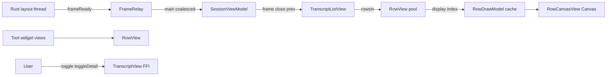

# Android native core transcript painter

## Goal

Replace the M1 Compose `Text` + `messageText` path with a native Android painter that consumes `LayoutFrame.display(index)` (`RowDisplay`, placements, styles) while preserving Rust layout geometry. Demo and live sessions keep M3b composer/send/auth; users can inspect rich markdown via demo workspace sessions and a dedicated transcript lab entry.

## Non-goals

- Rust/protocol changes, third-party markdown parsers, WebView rendering.
- Network image loading, live agent `Visual` sessions (placeholder + a11y only).
- CI Gradle builds on this VPS task (device visual validation pending).
- Modifying `crates/**`, iOS, scripts, workflows, or generated bindings.

## Status (2026-10-22)

Review blockers addressed in `apps/android/**`: Geist via `createFromAsset`, math via `Font.Builder` + `Canvas.drawGlyphs` (API 31+) with explicit `MATH_REFERENCE_SIZE` on the paint, logical-dp viewport + canvas density scale, scroller inner `FrameLayout`, frame lifecycle (revision idempotency closes duplicate wrappers; `renderEpoch` on theme/style), hydration on `frameReady` + app refresh tick, lab **Replay streaming** top-bar action (composer locked in lab), JVM unit tests wired via lazy `tasks.matching { assembleDebug }`.

**Rollback:** Revert the `feat/android-native-transcript` branch; no schema or Rust changes.

## Verified sources

| Area | Path |
|------|------|
| Display contract | `crates/mobile/src/layout/display.rs`, `mod.rs` (`display`, `rowsIn`, `placement`) |
| iOS reference | `apps/ios/Zeron/Transcript/*`, `Design/Palette.swift`, `Core/Fonts.swift` |
| Kotlin FFI (names/types) | `/root/.hermes/profiles/girlfriend/cache/scratch/kbind/uniffi/zeron_core/zeron_core.kt` |
| `closeView` patch | `scripts/android/patch-kotlin-bindings.py` (read-only) |
| Recon | `/root/.hermes/profiles/girlfriend/cache/scratch/native-painter-recon.json` |
| Chip fix baseline | `c51aa858` (`ComposerBar.kt` compact typing-only chips) |

## Decisions

1. **Hosting**: `TranscriptListView` (`NestedScrollView` + pooled `RowView`) inside Compose `AndroidView`; not a full `LazyColumn` of text.
2. **Coordinates**: Viewport width = measured content width in **logical dp** (container minus 16dp padding), `setViewport(widthDp, fontScale)` with `fontScale` from `Configuration.fontScale`. Row views and widgets use px layout params = dp × density; `RowCanvasView` scales the canvas by density so Rust geometry stays in dp.
3. **Fonts**: Shared `GeistTypefaces` from assets for `AndroidPlatformMeasurer` and `StyleFonts`; missing assets fail fast (no silent system fallback).
4. **Enumeration**: Virtualize with `frame.rowsIn(y0, y1)` + `placement`; cache `RowDrawModel` keyed by `(key, version, width)` (cap ~500), built synchronously on main (no background prefetch).
5. **Frames**: `FrameRelay` coalesces `frameReady`; capture scroll anchor before closing previous frame; compute empty/first-row before close; revision idempotency closes unused `frame()` wrappers (`current === frame` never holds); theme/style bumps `renderEpoch` and reconfigures visible rows; all FFI on main thread.
6. **Lab**: Demo session id `__zerona_transcript_lab__` uses `setDebugEntries` without `attach`. Static fixture markdown is laid out (widgets in fixture content only). **Replay streaming** (top bar) streams UTF-16-safe prefixes of lazy `layoutFixtureMarkdown()` into fixed id `a-stream`. Composer locked in lab; does not claim to test live host tool streams.
7. **Math**: `mathFontData` + `Font.Builder` / `Canvas.drawGlyphs` isolated in `MathGlyphsApi31` (`@RequiresApi(31)`); `RowDrawModel` / `MathFonts` facade use only `Canvas` + primitives so minSdk 26 never loads `android.graphics.fonts.Font`. API &lt; 31: labeled “Math” placeholder at glyph bounds (no silent empty square). Reference size 16 (matches iOS `Fonts.mathReferenceSize`; no separate FFI).
8. **Widgets**: Native controls for copy, disclosure, tool status/spinner/working (elapsed label ticks), toggles (`!open`), detail `AlertDialog` + copy, simplified tool rail/shimmer (animator tied to attach/detach).

## Data flow

## Tests

| Layer | Status |
|-------|--------|
| JVM unit (18 `@Test` methods in 6 classes, no JNA): UTF-16 slice/clamp/`isValidRange`/surrogate, per-scalar advance aggregation (`TextMeasureAdvances`), link hit-test (scroller viewport), anchor helpers, cache key equality, streaming prefix targets | Under `app/src/test`; `tasks.matching { assembleDebug }` depends on `testDebugUnitTest` |
| Rust layout | Existing `crates/mobile` tests (out of scope) |
| `assembleDebug` / on-device | **Pending** — not run on this VPS (no Android SDK compile here) |

### Manual acceptance (pending device)

- [ ] Large transcript scroll: no duplicate messages, tool-only rows visible, stable FPS
- [ ] Font scale 0.85–1.3: layout reflow matches paint
- [ ] Code block horizontal scroll + copy button
- [ ] Streaming tail veil on growing row
- [ ] Tool group disclosure, tool toggle detail, working/spinner chrome
- [ ] http/https links open externally; other schemes ignored
- [ ] Rotation / session switch / follow-tail vs anchor
- [ ] Demo lab + live session composer send regression
- [ ] Long-press copy uses `copyText`
- [ ] Lab replay streaming streams fixture markdown; live tool streams still session-only

## Known limitations

- `reveal_ms` on `TextRun` not animated (same as iOS painter).
- Tool rail connector animation simplified vs iOS `ToolRailView`.
- Shimmer is a reduced gradient sweep.
- Images (`pending://` / remote) and `Visual` widgets: placeholder only.
- Math glyphs on API &lt; 31: labeled placeholder, not TeX layout.
- Desktop tool/file icon assets not bundled; generic Material icons for named icons where possible.
- Live session tool *streams* (host-driven) not simulated in lab; only fixture markdown + scripted `setDebugEntries` streaming.
