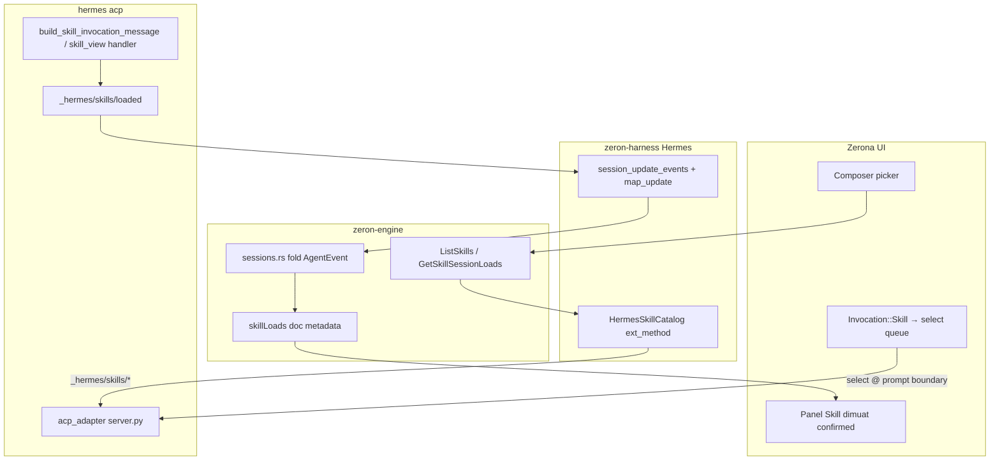

# Rencana: Manajemen skill Hermes di Zerona (kompatibilitas Hermes maksimal)

**Mode dokumen:** rencana implementasi saja — tanpa kode, tanpa skrip baru, tanpa commit, tanpa edit live Hermes/profil pengguna.  
**Baseline worktree Zerona:** `f5629e5ee0467afd125579abc2dc53adf97a9bb4` (`origin/main`).  
**Hermes sumber terpasang (verifikasi):** `/usr/local/lib/hermes-agent` @ `e06df9c2eae6901f4c88f464e0ae6e753c0428b8`.  
**Python / SDK ACP (verifikasi parent, 2026-10-14):** `/usr/local/lib/hermes-agent/venv/bin/python3` (Python 3.11, site-packages `acp`) — `import acp` dan model schema berhasil; **bukan** shell global workspace.

**Implementasi kode (fase berikutnya):** dikerjakan di instance **Cursor personal (`cursor-me`)**, diff minimal, tanpa `cargo fmt`/reformat seluruh repo, revisi sumber Hermes/Zerona dipin di commit message.

**Runtime penyusunan rencana (VPS):** dokumen ini disusun **tanpa** `cargo build` / `nextest` penuh di VPS. Perintah verifikasi §7 adalah **target implementasi mendatang** di **CI / Mac dev** — **jangan** menjalankan perintah berat itu di VPS hanya untuk validasi rencana; **jangan** mengklaim hasil tes sudah lulus.

**Dokumentasi web (curl, 2026-10-14):** [Skills System](https://hermes-agent.nousresearch.com/docs/user-guide/features/skills) ↔ `website/docs/user-guide/features/skills.md`; [ACP Internals](https://hermes-agent.nousresearch.com/docs/developer-guide/acp-internals) ↔ `website/docs/developer-guide/acp-internals.md`. Klaim wire/API di bawah mengacu **hanya** pada sumber terpasang + introspection SDK di venv di atas kecuali label *docs web*.

**Panduan AGENTS:** tidak ada `AGENTS.md` di repositori Zerona pada baseline ini.

---

## 0. Target kompatibilitas (deterministik)

| Mode | Descriptor `capabilities.hermesSkillLoads` | Panel “skill dimuat” (confirmed) | Katalog picker |
|------|--------------------------------------------|----------------------------------|----------------|
| **`wire_v2_acp` (acceptance penuh)** | `wire_v2_acp` setelah handshake `_meta` | Hanya event otoritatif `_hermes/skills/loaded` + meta `skillLoad` pada tool call (bukan fake tool) | `ext_method('hermes/skills/catalog', …)` → wire `_hermes/skills/catalog` |
| **`observed_tools_v0` (degraded)** | `observed_tools_v0` bila ekstensi Hermes belum ada | **Selalu kosong** kecuali ada bukti terstruktur H1/H2 (§6.2); Hermes lama paling banyak **`skill_view` teramati** di section terpisah — **bukan** hitungan load, **bukan** `skills_list` | Sama + badge `degraded`; fallback katalog `filesystem_degraded` (T4) bila RPC gagal |

**Pemisahan repo:** Zerona (`crates/*`) vs Hermes upstream (`acp_adapter/*`, `tools/*`, … di `/usr/local/lib/hermes-agent`). Patch Hermes (§6.2) adalah **satu keputusan opsional** di akhir dokumen; rencana Zerona tetap lengkap tanpa menunggu patch.

**Aturan keras panel confirmed**

- Daftar “dimuat” = subset ledger dengan `confidence: wire_authoritative` dan status `loaded_*` (§4.1).
- **`failed` / `abandoned` tidak pernah** masuk daftar confirmed — hanya section **“Gagal / dibatalkan”** terpisah.
- `selected`, `pending_delivery`, `accepted` (select RPC), `unobservable` **tidak** masuk confirmed.
- Section **“Observed reads (degraded)”** (opsional UI): hanya `skill_view` terminal di transkrip — **`skills_list` dikecualikan** (listing metadata, bukan pembacaan isi skill, bukan load).

---

## 1. Ruang lingkup dan UX (default tetap)

### 1.1 Dalam lingkup

| Area | Ya | Catatan |
|------|----|---------|
| Cari / daftar / inspect skill untuk composer | ✓ | Reuse picker `$` / `/` (`composer.rs`, `skill_completion`) |
| Skill **benar-benar dimuat** di sesi aktif | ✓ | Panel sesi; confirmed hanya §0 |
| Harness Hermes (`HarnessId::Hermes`, `hermes acp`) | ✓ | Target `wire_v2_acp` |
| Persistensi + resume + compaction | ✓ | Metadata turunan di `SessionDoc` (§5); **tanpa** UI clear/delete state user |

### 1.2 Di luar lingkup

- Enable/disable skill, `skill_manage`, install/hub/uninstall, kurasi plugin, edit `config.yaml` / `.env`, `state.db`, profil harness lain.
- Harness non-Hermes (tetap `skills.rs` generik; tidak diperluas fase ini).
- Scan filesystem Zerona sebagai katalog otoritatif Hermes (kecuali fallback T4 berlabel).
- Force-load lewat system prompt / past turn injection di Zerona; suppress otomatis `skill_view` model.
- Mode alternatif select (`inject_user_message`, `request_skill_view`) — **dihapus**; satu jalur kanonik §3.5.

### 1.3 UX (default produk)

1. **Picker:** `ListSkills` + `ListCommands` (`crates/rpc/src/lib.rs:54` `LIST_SKILLS`, handler `crates/engine/src/rpc.rs:1878-1904`, `composer.rs`). Badge `authoritative` / `degraded` dari `catalogSource`.
2. **Inspect:** `ext_method('hermes/skills/inspect', …)` — metadata + cuplikan `SKILL.md` read-only. **Preview tidak** memanggil `skill_view` sesi, **tidak** injeksi konteks, **tidak** menjalankan dynamic preprocess / shell plugin (`tools/skills_tool.py:697-714`, `skills_tool_dedup.py:77-80`). Entri dengan `readiness: unknown` = belum ada eksekusi load/preprocess (preview-only); **bukan** `setup_needed` dan **bukan** bukti dimuat.
3. **Panel “Skill dimuat”:** pola `todo_panel.rs` + `shell::SessionPanels`; default tertutup (`shell.rs:739-742`). Confirmed §0; gagal §4.1 terpisah.
4. **Bahasa:** “Dipilih / diterima (select)” ≠ “Dimuat (confirmed)” ≠ “Tool read teramati (degraded, skill_view saja)”.

### 1.4 Diagram alur



---

## 2. Keadaan saat ini (terverifikasi)

### 2.1 Zerona

| Topik | Lokasi | Gap |
|-------|--------|-----|
| Root skill scan | `crates/harness/src/skills.rs:148-154` | Tidak setara `get_skill_search_roots` Hermes |
| `skill_dirs` kosong | `crates/harness/src/acp/mod.rs:419` | `skill_commands()` tidak menambah slash skill Hermes |
| Delivery chip | `crates/proto/src/invocation.rs` `harness_prompt` | `Invocation::Skill` → `"Use the skill [name](path)"` — **bukan** load |
| Normalize ACP | `crates/harness/src/acp/normalize.rs:168-343` | `skill_view` → `kind: read`; `rawInput` belum di start (H1) |
| Notifikasi sesi | `crates/harness/src/acp/mod.rs` **`session_update_events`** (`2918-2941`) | Sudah memfilter `sessionId`; cabang Grok `_x.ai/session_notification` — **belum** cabang `_hermes/skills/loaded` |

### 2.2 Hermes — tool & ACP presentasi

| Topik | Lokasi | Implikasi Zerona |
|-------|--------|------------------|
| `skills_list` | `tools/skills_tool.py:248-275` | Listing + side effect metadata — **bukan** load, **bukan** “skill read” untuk panel |
| `skill_view` | `672-688`, `635-652` | Load agent sebenarnya |
| Formatter complete | `acp_adapter/tools.py:298-315` | Teks `**Skill loaded**` — **bukan** bukti load baru |
| Start event | `tools.py:766` | Argumen di **content**, bukan `rawInput` |
| `_meta` Hermes | `acp_adapter/provenance.py:80-86` | Pola `_meta.hermes.*` sudah ada |

### 2.3 Slash / ekspansi skill

ACP `prompt()`: slash ∉ `_COMMANDS` → prompt teks biasa (`commands.py:92-99`, `server.py:833-844`). `run_conversation` **tidak** memanggil `build_skill_invocation_message`. Load terkonfirmasi memerlukan adapter RPC §3.5 atau injeksi internal setelah **select** di boundary prompt.

### 2.4 `skills.auto_load`

Injeksi system prompt (`agent/system_prompt.py:317-341`) — **bukan** tool call. Observabilitas: notifikasi `_hermes/skills/loaded` **setelah** konteks benar-benar ter-commit ke prompt stabil (§4.2), dengan buffer/replay untuk event yang terjadi **sebelum** `session/new` ACP selesai (§5.5).

### 2.5 SDK ACP Python (introspection terverifikasi)

Interpreter: `/usr/local/lib/hermes-agent/venv/bin/python3`.

| Temuan | Detail |
|--------|--------|
| Model tool | `ToolCallStart` / `ToolCallProgress` memiliki `field_meta` (alias wire **`_meta`**), `raw_input`, `raw_output` |
| Dump alias | `ToolCallStart(field_meta={'hermes':{'skillLoad':{'schemaVersion':1}}}, tool_call_id='tc-test', title='test', session_update='tool_call').model_dump(by_alias=True, exclude_none=True)` → `_meta` seperti di atas |
| RPC ekstensi | `Agent.ext_method(method, params)` didukung; `AgentSideConnection.ext_method` → `send_request(f'_{method}', params)`; `ext_notification` → `send_notification(f'_{method}', params)` |
| Pemetaan Zerona | Client memanggil `ext_method('hermes/skills/catalog', params)`; on-wire method = **`_hermes/skills/catalog`** (idem `inspect`, `select`) |

---

## 3. Katalog skill: profil, plugin, kontrak ACP

### 3.1 Prinsip

Katalog dan inspect **profil-terikat** ke proses `hermes acp` yang sudah di-`session/new` untuk `sessionId` tersebut — **sesi chat aktif yang sama**, bukan sesi probe/temporary hanya untuk listing. Client **wajib** mengirim `sessionId`; server Hermes menyelesaikan `HERMES_HOME`, cwd, dan profil dari **SessionState terikat** — menolak `profileKey` / `cwd` / path dari client yang tidak cocok dengan sesi. Bootstrap katalog saat startup UI/engine mengikuti aturan yang sama (harness Hermes + `sessionId` terikat), bukan subprocess one-off.

### 3.2 CLI `hermes skills list`

Human-readable saja; **bukan** baseline katalog. Tidak dipakai sebagai sumber kebenaran di rencana final.

### 3.3 Sumber katalog (satu jalur + satu fallback)

| Prioritas | Mekanisme |
|-----------|-----------|
| **Utama** | `_hermes/skills/catalog` via `ext_method` |
| **Fallback UI** | `skills::discover` Zerona dengan `catalogMode: filesystem_degraded` + banner |

Subprocess parse CLI / `python -c` import — **tidak** masuk rencana produk.

### 3.4 `available_commands` ACP

Tetap built-in. Skill di composer = `Invocation::Skill` + alur **select** §3.5, bukan native ACP command.

### 3.5 Kontrak ACP (deterministik, on-wire)

**Namespace on-wire (JSON-RPC method):**

| Wire method | SDK call | Arah |
|-------------|----------|------|
| `_hermes/skills/catalog` | `ext_method('hermes/skills/catalog', params)` | request/response |
| `_hermes/skills/inspect` | `ext_method('hermes/skills/inspect', params)` | request/response |
| `_hermes/skills/select` | `ext_method('hermes/skills/select', params)` | request/response |
| `_hermes/skills/loaded` | `ext_notification('hermes/skills/loaded', params)` | server → client |

**Handshake capability (initialize / session):** `_meta.hermes.skills` (schemaVersion, supported methods, `resolverEpoch` opsional) — tanpa menambah discriminator `sessionUpdate` custom.

**Request umum (semua RPC di atas):**

```json
{
  "sessionId": "<acp-session-id>",
  "schemaVersion": 1
}
```

Server: resolve profil + cwd dari SessionState; `loadName` selalu **kanonik** dari resolver Hermes; tolak mismatch path/profile dari client (`profileMismatch`, `cwdMismatch`).

**`HermesSkillCatalogRequest` (catalog):**

```json
{
  "sessionId": "…",
  "schemaVersion": 1,
  "pagination": { "cursor": "string|null", "limit": 200 },
  "includeDisabled": false,
  "includeHiddenTierAliases": false
}
```

**`HermesSkillCatalogEntry` (bounded):**

```json
{
  "loadName": "canonical-name",
  "displayName": "string",
  "identity": {
    "kind": "path|native|plugin",
    "path": "absolute-or-null",
    "pluginId": "string|null",
    "qualifiedName": "plugin:skill|null"
  },
  "tier": "builtin|local|hub|plugin|external_project",
  "enabled": true,
  "hidden": false,
  "readiness": "ready|setup_needed|unknown",
  "setupNeeded": false,
  "description": "string|null",
  "tags": ["string"]
}
```

`readiness: unknown` = belum ada eksekusi (inspect/preview tanpa load/shell preprocess); berbeda dari `setup_needed`.

**Response catalog:**

```json
{
  "schemaVersion": 1,
  "resolverEpoch": "opaque-string",
  "profileKey": "opaque",
  "entries": ["…HermesSkillCatalogEntry"],
  "nextCursor": "string|null",
  "partialFailures": [{ "loadName": "string|null", "code": "string", "message": "string" }]
}
```

Cache Zerona: keyed `(sessionId, profileKey, resolverEpoch)`; invalidasi saat `resolverEpoch` berubah atau sesi ganti profil.

**`HermesSkillInspectRequest`:**

```json
{
  "sessionId": "…",
  "schemaVersion": 1,
  "loadName": "canonical",
  "filePath": "optional-override-resolver-validates"
}
```

**`HermesSkillInspectResponse`:**

```json
{
  "schemaVersion": 1,
  "loadName": "canonical",
  "identity": { "kind": "path|native|plugin", "path": "…", "pluginId": null, "qualifiedName": null },
  "readiness": "ready|setup_needed|unknown",
  "setupNeeded": false,
  "markdownExcerpt": "bounded UTF-8",
  "excerptTruncated": true,
  "resolverEpoch": "…"
}
```

Tidak memanggil handler `skill_view` sesi; tidak menjalankan preprocess shell.

**`Hermes/skills/select` — satu semantik**

- Request: `{ "sessionId": "…", "schemaVersion": 1, "selections": [{ "loadName": "canonical", "filePath": null|validated }] }` — **urutan array = urutan multiselect**.
- Response: `{ "accepted": true, "queuedForPrompt": true, "canonicalSelections": [...] }` — **`accepted` ≠ dimuat**; load confirmed hanya setelah `_hermes/skills/loaded` / injeksi commit.
- Staging **hanya** untuk **prompt user berikutnya** yang benar-benar dikirim lewat ACP `session/prompt` (boundary): ekspansi Hermes `build_skill_invocation_message` (atau setara internal) **atomik** dengan teks user — bukan inject pesan palsu, bukan minta model memanggil `skill_view`.
- **Select → prompt race (wajib):** staging terikat `(operationId|promptId, resolverEpoch)` (plus revisi staging server jika ada). Satu `session/prompt` **atomik** mengonsumsi **hanya** staged set yang cocok dengan id + `resolverEpoch` aktif; retry kirim dengan id sama **idempotent** (tidak double-load). Batal kirim / hapus draft / skip send **membersihkan** staging terikat id tersebut — **tidak** bocor ke prompt berikutnya yang tidak terkait. Validasi skill hilang/disabled/`resolverEpochStale` di **boundary send** (bukan hanya di picker); default **tolak atomik** seluruh seleksi jika ada entri invalid. User biasa tetap boleh mengirim **teks polos tanpa pick** skill.
- Jika sesi busy (turn berjalan): select **mengganti** antrean pending untuk prompt berikutnya (bukan inject mid-turn); boleh menghapus pending tanpa load.
- Terjemahan composer: `Invocation::Skill` / chip skill → entri `selections` — **bukan** fake file path; path hanya bila resolver mengizinkan reference load.

**Errors (kode di `error.data`):** `incompatibleSchema`, `sessionNotFound`, `profileMismatch`, `cwdMismatch`, `skillNotFound`, `skillDisabled`, `ambiguousName`, `resolverEpochStale`, `sessionBusy` (hanya jika explicitly rejected — default queue).

**Timeout:** catalog 30s; cancel client tidak mengubah sesi agent.

---

## 4. Semantik load & event schema

### 4.1 Status (ledger)

| Status | Panel confirmed? | Panel gagal? | Sumber |
|--------|------------------|--------------|--------|
| `selected` / `accepted` | Tidak | Tidak | UI / select RPC |
| `pending_delivery` | Tidak | Tidak | Antrean pre-prompt |
| `loaded_primary` | Ya | Tidak | Injeksi commit + meta |
| `loaded_reference` | Ya | Tidak | `file_path` ≠ default |
| `loaded_unchanged` | Ya | Tidak | dedup branch |
| `loaded_setup_needed` | Ya (badge) | Tidak | `setup_needed` |
| `failed` / `abandoned` | **Tidak** | **Ya** | tool gagal / flush open |
| `tool_observed_read` | Tidak (degraded section) | Tidak | Hanya **`skill_view`** teramati tanpa meta otoritatif |
| `unobservable` | Tidak | Tidak | Tanpa event terstruktur |

**Dihapus:** inferensi dari `**Skill loaded**`, marker slash, prose, `skills_list` sebagai read/load.

### 4.2 Event otoritatif (bukan fake tool call)

**Notifikasi:** `_hermes/skills/loaded` dengan payload `_meta.hermes.skillLoad` (dan/atau meta pada `tool_call`/`tool_call_update` nyata untuk `skill_view` — **tanpa** membuat tool call fiktif).

**Titik emit (Hermes):** **setelah** konteks skill **benar-benar ter-commit** ke state percakapan (handler `skill_view` sukses termasuk dedup branch, `build_auto_load_prompt` selesai dan tercantum di system prompt stabil, hasil `build_skill_invocation_message` pada boundary prompt select) — **bukan** saat resolver hanya mengembalikan teks ke RPC catalog/inspect, **bukan** hanya `build_tool_complete` tanpa commit.

Payload bounded (tanpa `content` skill, tanpa secret):

Params notifikasi **wajib** memuat `sessionId` **top-level** (selain isi `_meta`), karena `session_update_events` memfilter `sessionId` sebelum fold — sama seperti cabang notifikasi sesi existing. `childSessionKey` opsional bila event milik subagent (scope anak eksplisit).

```json
{
  "sessionId": "<acp-session-id>",
  "childSessionKey": null,
  "_meta": {
    "hermes": {
      "skillLoad": {
        "schemaVersion": 1,
        "eventId": "<producer-load-operation-id>",
        "loadName": "canonical",
        "displayName": "string",
        "filePath": "string|null",
        "terminalIdentity": "primary|reference|unchanged|failed|setup_needed",
        "outcome": "success|dedup|failed",
        "setupNeeded": false,
        "dedup": false,
        "contentReturned": true,
        "source": "skill_view|auto_load|prompt_select",
        "resolverEpoch": "string",
        "profileKey": "opaque",
        "acpSessionId": "wire",
        "toolCallId": "tc-*|null",
        "turnEpoch": 0,
        "processEpoch": "<uuid-per-process>"
      }
    }
  }
}
```

**`eventId`:** ID operasi load dari **producer** (Hermes), stabil untuk idempotensi replay — **tidak** memasukkan `terminalIdentity` (bisa berubah pada update). Update status untuk operasi yang sama memakai **`eventId` sama** (monotonic field lain boleh berubah).

**`processEpoch`:** UUID/nonce unik per proses agent, dipersist di metadata sesi untuk replay; **jangan** mengasumsikan counter numerik monotonic antar restart.

**Lineage:** binding stabil `(chat_id, profileKey, acpSessionId, eventId)`; agregasi UI per `loadName` kanonik dengan retensi event per-file/reference di bawah entri agregat.

### 4.3 Degraded `observed_tools_v0`

- Panel **confirmed tetap kosong** tanpa H1/H2 + structured meta.
- Section opsional: tool terminal **`skill_view` saja** — parse `rawInput` (H1) / `_meta` / content start deterministik (`tools.py:766`); **jangan** promote dari judul preview atau Markdown complete.
- **`skills_list`:** tidak masuk observed reads, tidak masuk confirmed.

### 4.4 Tabel keputusan deteksi load (ledger)

Hanya baris dengan meta terstruktur otoritatif (`_hermes/skills/loaded` atau `tool_call(_update)` nyata + `_meta.hermes.skillLoad`) mempromosikan status **confirmed**. Hermes lama tanpa meta → **observed-only** (`skill_view` terminal, §4.3), **bukan** confirmed.

| `outcome` | `terminalIdentity` | Status ledger | Panel |
|-----------|-------------------|---------------|-------|
| `success` | `primary` | `loaded_primary` | confirmed |
| `success` | `reference` | `loaded_reference` | confirmed |
| `dedup` | `unchanged` | `loaded_unchanged` | confirmed |
| `success` | `setup_needed` (atau `setupNeeded: true`) | `loaded_setup_needed` | confirmed (badge) |
| `failed` | `failed` (atau tool abandon) | `failed` / `abandoned` | section gagal saja |
| — | — | `tool_observed_read` | degraded observed (`skill_view` saja) |
| — | — | `unobservable` | tidak dipromosikan |

**Caption metadata historis:** proyeksi doc mencatat skill yang **pernah** dimuat (bukti terstruktur di atas) meskipun compaction/resume menghapus isi dari konteks model — label UI **“historical / ever loaded”**, **structured-only**; tidak menginfer dari prose `**Skill loaded**` atau `skills_list`.

### 4.5 Zerona: map notifikasi

Di `session_update_events` (`crates/harness/src/acp/mod.rs:2918-2941`), tambah cabang:

```text
"_hermes/skills/loaded" => map_skill_loaded_notification(params, session_id) -> Vec<AgentEvent>
```

Sama filter `sessionId` seperti cabang existing; jangan gabungkan ke parent subagent tanpa `childSessionKey` eksplisit.

---

## 5. Identitas, dedup, persistensi, resume

### 5.1 Identitas native Hermes di wire Zerona (`Skill.path`, `Invocation::Skill.path`)

- Field `path` pada `Skill` / `Invocation::Skill` tetap **String wajib** (`crates/proto/src/invocation.rs`); `native_skill_identity()` sudah mengenali URI `harness-skill:` (bersama `opencode-skill:`).
- Entri katalog Hermes di picker/engine memakai identitas **backward-compatible**: URI namespace `harness-skill:` — **bukan** path filesystem palsu. Bentuk kanonik proposed: `harness-skill:hermes:{opaqueStableId}` dengan `opaqueStableId` stabil (serde) dan **terikat** `loadName` kanonik resolver Hermes (encode/decode roundtrip + default serde diuji).
- `harness_prompt` untuk `HarnessId::Hermes`: **jangan** memancarkan tautan Markdown ke file yang tidak ada; untuk native Hermes gunakan semantik `native_skill_identity` (nama / perintah advertised), sama seperti provider native lain — **harness non-Hermes tidak diubah** perilaku existing.
- Reference load dengan path disk nyata tetap hanya bila resolver mengembalikan path absolut tervalidasi (bukan invent client).

### 5.2 Kunci & dedup

- Partition ledger per `profileKey` / `chat_id`.
- Subagent: default tidak merge ke parent (`sessions.rs` nested meta).
- Late `tool_call_update` / notifikasi duplikat: idempotent pada `eventId` producer.

### 5.3 Cancel / late results

- Abandoned tool → `failed` di section gagal.
- Cancel turn tidak menghapus load confirmed sebelumnya.
- Select RPC cancel tidak memuat skill.

### 5.4 Persistensi `SessionDoc`

- Field `skillLoads` (proposed), `schemaVersion` mengikuti `SESSION_SCHEMA_VERSION` (`crates/doc/src/constants.rs:27`).
- Proyeksi dari fold transkrip + event meta; rebuild penuh jika field hilang.
- Tidak menyimpan isi `SKILL.md` di metadata.

### 5.5 Compaction, resume, riwayat

- Metadata mencatat skill yang **pernah** dimuat dengan bukti otoritatif, meskipun konteks model **tidak lagi** memuat isi skill setelah compaction/resume.
- Versi schema metadata **backward compatible** (unknown field diabaikan; migrasi doc satu arah).
- Replay startup: buffer event `_hermes/skills/loaded` / auto_load yang terjadi sebelum klien ACP selesai subscribe — disimpan dengan `eventId` stabil dan di-replay ke fold setelah `session/new`.
- **Tidak** ada UI clear/delete state skill load dalam fase ini.

---

## 6. Implementasi & tugas (8–12 item, dengan dependensi)

### 6.1 Registrasi modul / schema (wajib disebut)

| Area | Path |
|------|------|
| Konstanta RPC engine↔UI | `crates/rpc/src/lib.rs` (`LIST_SKILLS` ≈ baris 54; tambah `GetSkillSessionLoads` di modul yang sama — **bukan** `crates/proto/src/rpc.rs`, file itu tidak ada) |
| Handler RPC | `crates/engine/src/rpc.rs` (`LIST_SKILLS` handler ≈ 1878; handler baru `GetSkillSessionLoads`) |
| DTO wire | `crates/proto/src/agent.rs` (`HermesSkillLoadMeta`, status enum); mirror catalog/inspect/select di `crates/proto/src/invocation.rs` **atau** `crates/proto/src/skill.rs` baru — **`pub mod skill;` + re-export eksplisit di `crates/proto/src/lib.rs`** |
| Doc schema | `crates/doc/src/schema.rs` field `skillLoads`, `crates/doc/src/constants.rs` version bump |
| Harness wire | `crates/harness/src/acp/hermes_skill_wire.rs`, `crates/harness/src/hermes/skills_catalog.rs`, cabang `session_update_events` di `crates/harness/src/acp/mod.rs` |
| Engine fold | `crates/engine/src/sessions.rs` (`apply_hermes_skill_load_meta`, `merge_skill_loads_into_doc`) |
| UI | `crates/ui/src/skill_session_panel.rs`, `composer.rs`, `shell.rs` |

### 6.2 Hermes upstream (companion patch — gated)

| ID | File | Perubahan |
|----|------|-----------|
| H1 | `acp_adapter/tools.py` | `skill_view`: `rawInput=arguments` pada start |
| H2 | `acp_adapter/tools.py` | `_meta.hermes.skillLoad` pada complete nyata + emit `_hermes/skills/loaded` pada commit injeksi |
| H3 | `agent/system_prompt.py`, `skill_commands.py` | auto_load + prompt_select emit setelah commit |
| H4 | `acp_adapter/server.py` | Handler `_hermes/skills/*`, SessionState, select queue terikat `operationId`/`promptId` + `resolverEpoch` |
| H5 | `tests/acp_adapter/test_tools.py`, tests baru `test_hermes_skills_ext.py` | RPC + notifikasi |

### 6.3 Tugas Zerona (urutan)

| ID | Tugas | Depends |
|----|-------|---------|
| T1 | DTO `HermesSkillCatalogEntry` / inspect / load meta + doc `skillLoads` schema; tes `harness-skill:` serde default + URI encode/decode | — |
| T2 | `HermesSkillCatalog`: `ext_method` catalog/inspect + fallback T4 + cache `resolverEpoch` | T1 |
| T3 | `AcpHarness::skills` + capability handshake `_meta.hermes.skills` | T2 |
| T4 | `session_update_events` cabang `_hermes/skills/loaded` + `map_skill_loaded_notification` | T1 |
| T5 | `normalize.rs` + `map_observed_tools_v0` (skill_view only, H1) | T4 |
| T6 | Engine fold + idempotent `eventId` + sections confirmed vs failed | T4, T5 |
| T7 | RPC `GetSkillSessionLoads` + composer select → `ext_method select` antrean prompt | T2, T6 |
| T8 | UI panel + badges + degraded empty confirmed | T7 |
| T9 | Fixture JSONL REDACTED + synthetic; register test `skill_session_ledger` | T6 |
| T10 | Wire `skill_session_ledger` ke `scripts/ci/test-core.sh` array | T9 |

**Rollback:** feature flags `hermes_skill_session_panel`, `hermes_skill_catalog_acp` — off → picker/panel lama; doc/transkrip tetap; tidak hapus metadata.

### 6.4 Acceptance

| Mode | Kriteria |
|------|----------|
| `wire_v2_acp` | Catalog/inspect/select via ext; load confirmed = `_hermes/skills/loaded` setelah commit; select `accepted` tanpa load sampai event; inspect/preview tanpa injeksi |
| `observed_tools_v0` | Confirmed kosong; optional skill_view reads; `skills_list` absent |

---

## 7. Matriks uji (target + degraded) & perintah

**Catatan:** perintah di bawah untuk implementasi mendatang — **tidak** ada klaim bahwa tes sudah dijalankan dalam penyusunan dokumen ini.

### 7.1 Matriks perilaku

| # | Skenario | Expected |
|---|----------|----------|
| M1 | `skill_view` sukses primary | confirmed `loaded_primary`, `eventId` stabil replay |
| M2 | reference `file_path` | `loaded_reference`, lineage per path |
| M3 | SKILL.md kosong (primary) | `loaded_primary` + `emptyFile` |
| M4 | dedup unchanged tanpa riwayat sebelumnya | stub `loaded_unchanged`, bukan primary |
| M5 | setup gagal / tool failed / abandoned | section gagal saja |
| M6 | cancel turn + late update | idempotent `eventId`, gagal tidak di confirmed |
| M7 | plugin qualified name | `qualifiedName` contoh `plugin:skill` (bukan `plugin:id/name` kecuali grammar upstream membuktikan) |
| M8 | external project roots / tier alias | `hidden` / `includeHiddenTierAliases` |
| M9 | remote `HERMES_HOME` | `profileKey` isolasi, tidak bocor ke chat lain |
| M10 | `auto_load` | `_hermes/skills/loaded` setelah system prompt commit; replay pre-session |
| M11 | multiselect select | urutan preserved, satu boundary prompt |
| M12 | inspect/preview | tidak ada injeksi konteks / shell preprocess |
| M13 | cross-profile / subagent | ledger partition, no parent merge default |
| M14 | restart + compaction | metadata historical tetap; konteks model mungkin tanpa isi skill |

### 7.2 Perintah verifikasi (Hermes tree)

```bash
/usr/local/lib/hermes-agent/venv/bin/python3 -m pytest \
  /usr/local/lib/hermes-agent/tests/acp_adapter/test_tools.py -q
# Setelah H4/H5:
/usr/local/lib/hermes-agent/venv/bin/python3 -m pytest \
  /usr/local/lib/hermes-agent/tests/acp_adapter/test_hermes_skills_ext.py -q
```

### 7.3 Perintah verifikasi (Zerona tree — CI / Mac dev, bukan VPS rencana)

Jalankan **setelah** implementasi T1–T10 di lingkungan CI atau Mac dev (`cursor-me`); **jangan** wajibkan build/test penuh di VPS penyusunan rencana.

```bash
cd /root/zeron-hermes-skill-management
cargo nextest run -p zeron-harness --test acp
cargo nextest run -p zeron-engine --test skill_session_ledger
./scripts/ci/test-core.sh   # setelah T10: skill_session_ledger masuk array baris 27-29
./scripts/run-macos-dev.sh  # smoke manual panel di macOS dev
```

---

## 8. Keamanan & rollback

- Env minimal: `HERMES_HOME`, `PATH`, cwd; jangan log `.env`.
- Server menolak cwd/profile client yang tidak cocok dengan SessionState.
- Rollback flags (§6.3); metadata doc tetap untuk audit riwayat.

---

## Keputusan opsional (satu)

**Companion patch Hermes (H1–H5)** di repo `/usr/local/lib/hermes-agent`: authorize sekarang untuk dibuka sebagai PR terpisah pada timeline yang sama dengan Zerona T1–T10, **atau** tunda dan shipment Zerona awal hanya dengan `observed_tools_v0` (confirmed kosong) sampai patch land. Rencana teknis di atas **tidak** berubah antara kedua pilihan; hanya gate acceptance `wire_v2_acp`.

---

## Lampiran: bukti cepat

| Item | Lokasi |
|------|--------|
| `session_update_events` | `crates/harness/src/acp/mod.rs:2918-2941` |
| `LIST_SKILLS` / engine RPC | `crates/rpc/src/lib.rs:54`, `crates/engine/src/rpc.rs:1878+` |
| SDK `_meta` / rawInput | venv §2.5 |
| `skill_view` schema | `tools/skills_tool.py:672-688` |
| Slash ACP | `commands.py:92-99` |
| `Invocation::Skill` prompt | `crates/proto/src/invocation.rs` `harness_prompt` |

---

## Ringkasan eksekutif

| Item | Ringkasan |
|------|-----------|
| Wire | `_hermes/skills/{catalog,inspect,select,loaded}` via `ext_method` / `ext_notification` |
| Confirmed | Hanya load meta otoritatif; gagal terpisah; degraded confirmed kosong |
| Select | Stage ke prompt berikutnya; `accepted` ≠ loaded; multiselect berurutan |
| SDK | Terverifikasi di venv Hermes 3.11; jangan klaim SDK tidak ada |
| Zerona hook | `session_update_events` + fold engine + doc `skillLoads` |
| Tes | Matriks M1–M14; perintah §7 untuk CI/Mac — **tidak** dijalankan / **tidak** diklaim lulus saat penyusunan rencana VPS |
| Identitas | `harness-skill:hermes:…` di `Skill.path`; `GetSkillSessionLoads` di `crates/rpc` + `engine/src/rpc.rs` |
